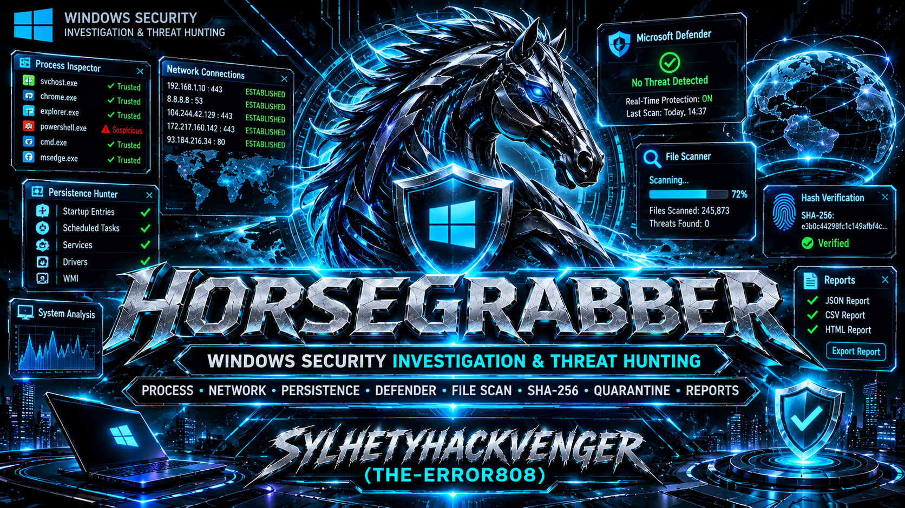

### HORSEGRABBER — Complete Installation & Execution Guide

Tool name: HORSEGRABBER Author: SYLHETYHACKVENGER (THE-ERROR808) File: `HorseGrabber.py`

I'll walk you through everything from installing Python to launching the application as Administrator and running your first malware investigation.

### STEP 1 — Download HORSEGRABBER

HORSEGRABBER.py

Python source file · 22 KB approximately

Ready

 Download HORSEGRABBER.py

Save the file in your Windows Downloads folder.

Expected location:

```text
C:\Users\YOUR_USERNAME\Downloads\HorseGrabber.py
```

### STEP 2 — Install Python


2.1. Open the official Python website

[Python for Windows — Official Download](https://www.python.org/downloads/windows/?utm_source=chatgpt.com)

2.2. Download Python

Choose a current stable Python 3 release for Windows (64-bit).

For example, Python 3.13 or a newer stable version.

2.3. Start installation

Open the downloaded installer.

![\[部署记录\]将AI接入QQ：AstrBot+NapCat - 开发调优 - LINUX DO](https://images.openai.com/static-rsc-4/21JKX15lYBeiGyLj9uiTNT-DriihVCiFOh0YZ81DZloIpDdK2a-nb1-ASSynAMKdxqQbckg-i3sYqaOWE0aUc963XviDeGP2JnadpNDPOGSoT_3eTUNVcmRMQvnsCiG1fkzX1Vfmq-KFPDuo1QK6jHJILD5lxeQnECPJH0tAHuPpNB6Z5o_h6rm-Wh2SE2hI?purpose=fullsize)

Important

On the first installation screen:

* Enable Add python.exe to PATH.

* Select Install Now.

* Wait until installation finishes.

* Select Close.

Do not skip the PATH checkbox. It makes running Python from CMD and PowerShell easier.

### STEP 3 — Verify Python installation

Open CMD:

* Press `Win + R`.

* Type `cmd`.

* Press Enter.

Execute:

```cmd
python --version
```

Expected result:

```text
Python 3.13.x
```

Your exact version may differ.

Next:

```cmd
pip --version
```

Expected result:

```text
pip 25.x from ...
```

If `python` is not recognized, try:

```cmd
py --version
```

If that works, Python is installed but its `python` command may not be configured in PATH.

### STEP 4 — Check Tkinter

HORSEGRABBER uses Tkinter to display its graphical interface.

In CMD:

```cmd
python -m tkinter
```

Expected outcome:

A small Tkinter test window opens.


If the window opens, close it.

If Tkinter is missing, reinstall Python using the official Windows installer and ensure the Tcl/Tk and IDLE feature is selected.

### STEP 5 — Prepare the application folder

Open CMD and execute these commands individually:

```cmd
mkdir C:\HorseGrabber
```

Copy the downloaded file:

```cmd
copy "%USERPROFILE%\Downloads\HorseGrabber.py" "C:\HorseGrabber\HorseGrabber.py"
```

Verify the file:

```cmd
dir C:\HorseGrabber
```

Expected result:

```text
Directory of C:\HorseGrabber

HorseGrabber.py
```

Your folder structure will be:

```text
C:\
 └── HorseGrabber\
      └── HorseGrabber.py
```

The application will automatically create its Reports and Quarantine directories inside your user profile.

### STEP 6 — Launch HORSEGRABBER

Open PowerShell as Administrator:

* Right-click Start.

* Select Terminal (Admin).

* Open PowerShell.

Execute:

```powershell
cd C:\HorseGrabber
```

Then:

```powershell
python HorseGrabber.py
```

If `python` is not recognized:

```powershell
py HorseGrabber.py
```

Expected outcome

The HORSEGRABBER graphical application should open.

### STEP 7 — Understand the application interface


The current version includes these controls:

| Button                   | Function                                                   |
| ------------------------ | ---------------------------------------------------------- |
| Run Full Hunt            | Collects multiple categories of evidence                   |
| Processes + Network      | Inspects processes and TCP connections                     |
| Persistence Hunt         | Inspects startup entries, tasks, services, drivers and WMI |
| Defender Check           | Checks Defender status and detections                      |
| File / Folder Scan       | Inspects a selected folder                                 |
| Hash Selected File       | Calculates a file's SHA-256                                |
| Quarantine Selected File | Manually moves a selected file into quarantine             |
| Export Report            | Generates JSON, CSV and HTML reports                       |

### STEP 8 — Run your first investigation

I recommend this sequence.

First: Defender Check

Click:

`Defender Check`

Review antivirus status and detection records.

Second: Processes + Network

Click:

`Processes + Network`

Review:

* Process names.

* PIDs.

* Executable paths.

* External IP addresses.

* Remote ports.

* TCP connection states.

Third: Persistence Hunt

Click:

`Persistence Hunt`

Review:

* Startup programs.

* Scheduled tasks.

* Services.

* Drivers.

* WMI subscriptions.

Fourth: File / Folder Scan

Select a folder you want to inspect.

For example:

```text
C:\Users\YOUR_USERNAME\Downloads
```

Review unfamiliar executables, scripts, and recently modified files.

Fifth: Export Report

Click:

`Export Report`

### STEP 9 — Locate investigation reports

The reports are automatically stored here:

```text
C:\Users\YOUR_USERNAME\HorseGrabber\Reports
```

To open this folder, execute:

```cmd
explorer "%USERPROFILE%\HorseGrabber\Reports"
```

You should see files similar to:

```text
HorseGrabber_Report_20261126_120000.json
HorseGrabber_Report_20261126_120000.csv
HorseGrabber_Report_20261126_120000.html
DNS_cache.txt
Proxy_settings.txt
```

The HTML report can be opened in Chrome or Edge.

### STEP 10 — Understand manual quarantine

Use with caution

If you select a suspicious file in the results table and click:

`Quarantine Selected File`

HORSEGRABBER will:

* Check that the file exists.

* Refuse files inside protected Windows and Program Files directories.

* Calculate the SHA-256 hash.

* Ask you for confirmation.

* Move the selected file into:

```text
C:\Users\YOUR_USERNAME\HorseGrabber\Quarantine
```

6\. Record the original path and hash in a quarantine manifest.

Important: This is manual file isolation, not complete malware removal. A running process, registry persistence, scheduled task, or associated malicious component may remain. Do not quarantine a system file or legitimate application merely because it looks unfamiliar.

### STEP 11 — Troubleshooting

| Problem                    | Solution                                                 |
| -------------------------- | -------------------------------------------------------- |
| python is not recognized   | Try py HorseGrabber.py                                   |
| No module named tkinter    | Repair/reinstall Python with Tcl/Tk                      |
| Application doesn't open   | Run python HorseGrabber.py from PowerShell to see errors |
| Access denied              | Open Terminal as Administrator                           |
| No Defender information    | Check that Microsoft Defender is available and enabled   |
| Some processes are missing | Run as Administrator                                     |
| Folder scan is slow        | Select a smaller folder                                  |

No additional pip packages are required by the current script.

### STEP 12 — Final installation checklist

Installation progress

### 0/13

Download HorseGrabber.py

Install Python 3 for Windows

Enable Add Python to PATH

Verify python --version

Test python -m tkinter

Create C:\\HorseGrabber

Copy HorseGrabber.py into the folder

Open PowerShell as Administrator

Launch python HorseGrabber.py

Run Defender Check

Run Processes + Network

Run Persistence Hunt

Export and inspect the HTML report

### One final recommendation

The current HORSEGRABBER is a first-generation defensive scanner. It collects useful evidence, but it does not yet provide continuous real-time monitoring, comprehensive ransomware behavior detection, automatic remediation, or reliable threat attribution.

For a stronger next version, I recommend adding:

* Real-time ransomware behavior monitoring.

* File-system change alerts.

* Process-tree investigation.

* Sysmon event correlation.

* Manual restore from quarantine.

* Browser and DNS redirection investigation.

* Threat-intelligence lookups for IPs and hashes.

* Detailed incident timelines.

Start by installing Python and launching the current version. Once it opens, you can share a screenshot of the interface or an exported report, with personal information and sensitive IPs redacted, and I can help interpret the findings.
